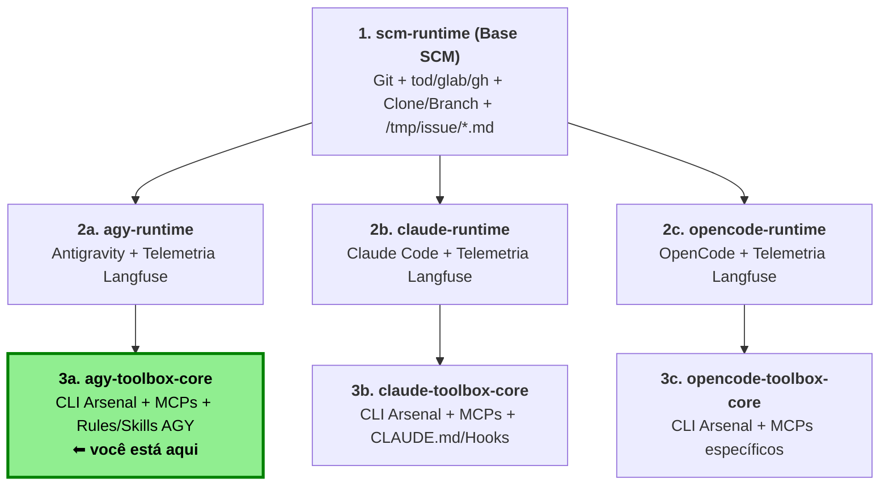

# agy-toolbox-core

Camada 3 da família `*-runtime` / `*-toolbox`: estende `agy-runtime` (camada 2) sobre `scm-runtime` (camada 1), adicionando o arsenal de ferramentas CLI via `mise` (`30-toolbox.toml`), utilitários de sistema (`apt`) e suporte a Docker-in-Docker rootless (`DIND=1`).

## O que esta camada adiciona

1. **Utilitários de sistema (`apt`)**: ferramentas de texto, diff, compactação, editores (`nano`, `vim`) e dependências para Docker rootless (`iproute2`, `uidmap`, `iptables`, `fuse-overlayfs`, `slirp4netns`).
2. **Arsenal de CLI (`mise`)**: configurado em `rootfs/home/agent/.config/mise/conf.d/30-toolbox.toml` (`ast-grep`, `bat`, `choose`, `dasel`, `delta`, `difftastic`, `docker-cli`, `buildx`, `docker-compose`, `duckdb`, `eza`, `fd`, `fzf`, `grex`, `gron`, `htmlq`, `jc`, `just`, `miller`, `python`, `qsv`, `ripgrep`, `ripgrep-all`, `scc`, `sd`, `shellcheck`, `shfmt`, `uv`, `watchexec`, `yq`).
3. **Docker-in-Docker rootless (`start-dockerd.sh`)**: binários `dockerd`/`containerd`/`runc` + `docker-rootless-extras`.

## Docker (padrão)

Sem `DIND`, o `docker-cli` usa o daemon externo definido em `DOCKER_HOST`
(padrão `tcp://host.docker.internal:2375`, ou o socket do host montado).

## Docker-in-Docker (`DIND=1`)

Com `DIND=1`, o `agy.sh` (herdado da camada 2) aciona o `start-dockerd.sh` para iniciar um `dockerd` **rootless** (como o usuário `agent`, sem sudo) e aponta `DOCKER_HOST` para `unix:///tmp/docker-1000/docker.sock`. Sem `DIND=1` nada muda.

Requer `--privileged` e um volume em `/home/agent/.local/share/docker` (o overlay2
não funciona sobre o overlayfs do próprio container):

```bash
docker build -t agy-toolbox-core:latest .

docker run -it --rm \
  --privileged \
  -e DIND=1 \
  -v agy-docker:/home/agent/.local/share/docker \
  --env-file .env \
  agy-toolbox-core:latest
```

Testar dentro do container:

```bash
docker info
docker run --rm hello-world
```

Variáveis:

- `DIND=1`: habilita o dockerd interno.
- `DOCKERD_STORAGE_DRIVER`: driver de storage (padrão `overlay2`; use `fuse-overlayfs` ou `vfs` se falhar).

Logs do daemon: `/tmp/docker-1000/dockerd.log`. Se ele não subir, o `agy` inicia mesmo
assim e mantém o `DOCKER_HOST` anterior.

### Docker-in-Podman

A imagem também deve funcionar com Podman como host (ainda não validado). Comece pela
opção sem `--privileged`:

```bash
podman build -t agy-toolbox-core:latest .

podman run -it --rm \
  --device /dev/fuse --device /dev/net/tun \
  --security-opt seccomp=unconfined \
  --security-opt apparmor=unconfined \
  --security-opt label=disable \
  --security-opt unmask=ALL \
  -e DIND=1 \
  -e DOCKERD_STORAGE_DRIVER=fuse-overlayfs \
  -v agy-docker:/home/agent/.local/share/docker \
  --env-file .env \
  agy-toolbox-core:latest
```

Se falhar, tente com `--privileged` (equivalente ao exemplo do Docker):

```bash
podman run -it --rm --privileged -e DIND=1 \
  -v agy-docker:/home/agent/.local/share/docker \
  --env-file .env agy-toolbox-core:latest
```

Notas:

- Em Podman rootless, o usuário do host precisa de um range grande em `/etc/subuid` e
  `/etc/subgid` (≥ 65536) para o `newuidmap` do dockerd aninhado funcionar.
- O overlay2 nativo costuma falhar dentro de user namespace: use
  `DOCKERD_STORAGE_DRIVER=fuse-overlayfs` (ou `vfs` como último recurso, lento).
- Se o daemon não subir, veja `/tmp/docker-1000/dockerd.log`.
- Alternativa sem DinD: `podman system service` e monte o socket no container, com
  `DOCKER_HOST` apontando para ele (sem `DIND=1`).

> **Segurança:** `--privileged` dá ao container acesso quase total ao host, e o
> `agy` roda com `--dangerously-skip-permissions`. Use só em ambiente confiável.
> Alternativa sem `--privileged`: `--runtime=sysbox-runc` (requer Sysbox no host).

---

## Exemplo de arquivo `.env` completo

> No `--env-file` do Docker, não use aspas nem `export` (o valor é lido literalmente) e mantenha comentários apenas em linhas próprias.

```dotenv
# ==============================================================================
# Camada 1: Repositório Git e Issue (scm-runtime)
# ==============================================================================

# Tipo da forja: onedev, gitlab ou github (obrigatório)
GIT_SERVER_TYPE=onedev

# URL HTTP/HTTPS do repositório a ser clonado em /workspace (obrigatório)
GIT_REPO_URL=http://onedev.example.com/org/repo.git

# Token de acesso pessoal (PAT / Access Token) da forja (obrigatório; fica só em memória)
GIT_TOKEN=seu_token_aqui

# (Opcional) Usuário enviado pelo credential helper HTTP (padrão: git)
GIT_USERNAME=git

# Branch base clonada inicialmente do remoto (obrigatório)
GIT_BASE_BRANCH=main

# Branch de trabalho (obrigatória se ISSUE_ID não estiver definido; criada a partir de GIT_BASE_BRANCH se não existir)
GIT_BRANCH=agent/minha-tarefa

# Identidade Git configurada no container para os commits (obrigatório)
GIT_USER_NAME=MyAgent
GIT_USER_EMAIL=myagent@example.com

# (Opcional) Co-autor humano adicionado automaticamente via hook prepare-commit-msg (formato: "Nome <email>")
GIT_CO_AUTHOR=Some human <somehuman@example.com>

# (Opcional) ID da issue a ser baixada para /tmp/issue/*.md (sobrescreve GIT_BRANCH para issue/<ISSUE_ID>)
#ISSUE_ID=123

# (Opcional) Modo autônomo: se true, executa sem interação humana, captura stdout e comenta na issue (exige ISSUE_ID)
#AUTONOMOUS_MODE=true

# (Opcional) Limite máximo de caracteres do stdout enviado como comentário na issue no modo autônomo (padrão: 60000)
#MAX_COMMENT_CHARS=60000

# (Opcional) Overrides de host/token para GitLab ou GitHub Enterprise (derivados de GIT_REPO_URL e GIT_TOKEN se omitidos)
#GITLAB_HOST=https://gitlab.example.com
#GITLAB_TOKEN=seu_token_gitlab
#GH_HOST=github.example.com
#GH_TOKEN=seu_token_github
#GH_ENTERPRISE_TOKEN=seu_token_ghe

# ==============================================================================
# Camada 2: Google Antigravity CLI (agy-runtime)
# ==============================================================================

# (Opcional) Prompt inicial enviado ao agy (-p no modo autônomo; -i no modo interativo; padrão autônomo com ISSUE_ID: "Resolva a issue #<ID>.")
#ISSUE_PROMPT=Resolva a issue

# (Opcional) Se true, inclui os comentários da issue (/tmp/issue/comments.md) nas rules do agente
#ISSUE_COMMENTS=true

# (Opcional) Modelo utilizado pelo Antigravity CLI (`agy --model`, consulte `agy models`)
#MODEL=gemini-4-argon-medium

# ==============================================================================
# Camada 2: Telemetria Langfuse (plugin langfuse-observability)
# ==============================================================================

# (Opcional) URL base e chaves do projeto no Langfuse (se omitidas, nenhum trace é enviado)
LANGFUSE_BASE_URL=http://langfuse.example.com
LANGFUSE_PUBLIC_KEY=pk-lf-xxxxxxxxxxxxxxxxxxxxxxxxxxxxxxxx
LANGFUSE_SECRET_KEY=sk-lf-xxxxxxxxxxxxxxxxxxxxxxxxxxxxxxxx

# (Opcional) Identificador do usuário no trace (fallback automático: e-mail de GIT_CO_AUTHOR -> GIT_USER_EMAIL)
#LANGFUSE_USER_ID=some-user

# (Opcional) Tags extras no trace do Langfuse separadas por vírgula (padrão: mode:interactive ou mode:autonomous)
#AGY_LANGFUSE_TRACE_TAGS=mode:interactive,env:dev

# ==============================================================================
# Camada 3: Docker e Docker-in-Docker (agy-toolbox-core)
# ==============================================================================

# (Opcional) Daemon Docker externo quando DIND não está ativo (ex.: socket montado ou TCP)
#DOCKER_HOST=unix:///var/run/docker.sock

# (Opcional) Se 1, inicia o dockerd rootless interno via start-dockerd.sh (requer --privileged ou equivalente)
#DIND=1

# (Opcional) Driver de storage do dockerd interno quando DIND=1 (padrão: overlay2; alternativas: fuse-overlayfs, vfs)
#DOCKERD_STORAGE_DRIVER=overlay2
```


